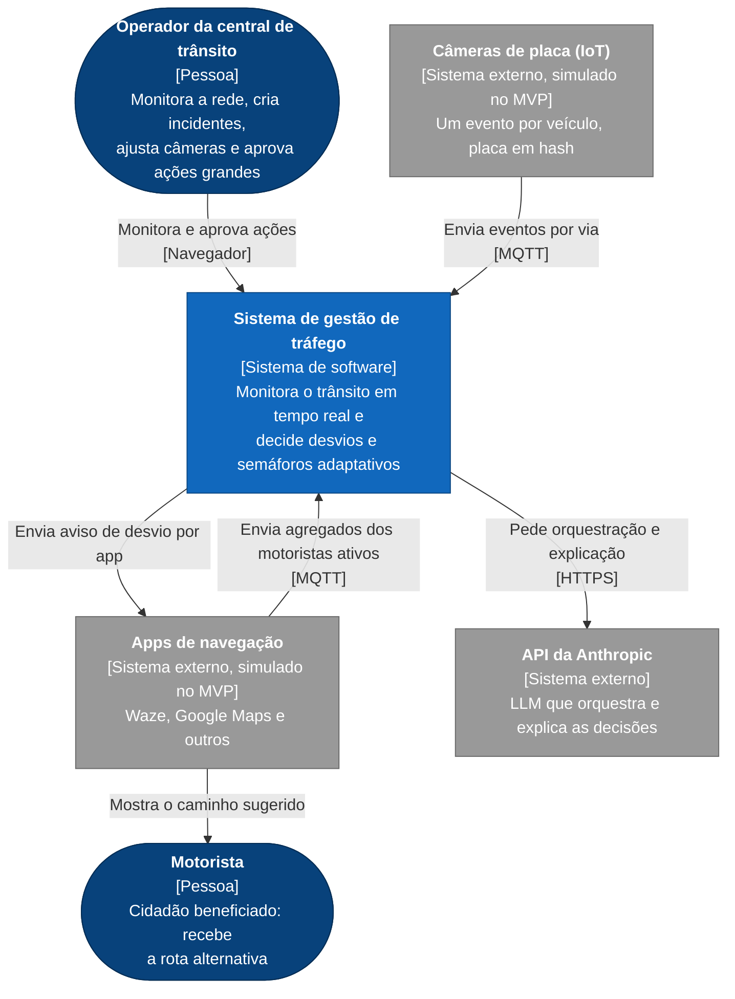
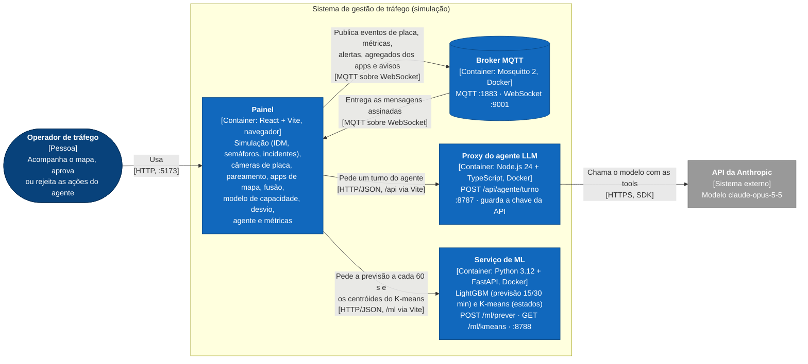

# Getting started

Para instalar e rodar, veja o [DEVELOPMENT.md](DEVELOPMENT.md). Este documento explica **para que
serve a ferramenta, o que ela faz e quais conceitos ela usa**.

## Propósito

Painel de gestão de tráfego para o **operador da central de trânsito**. A ferramenta simula o
trânsito de uma grade de 4×4 ruas reais dos Jardins, em São Paulo, mede a rede com pares de
câmeras que leem placas e decide como agir quando há congestionamento: ajusta os semáforos e avisa **só
uma parte** dos motoristas que usam app de mapa, sugerindo um caminho mais rápido.

**Hipótese do TCC:** notificar apenas uma parcela calculada dos motoristas reduz o tempo médio de
viagem e as emissões de CO₂ mais do que notificar todos ou não fazer nada.

**Impacto:** menos tempo parado e menos anda-e-para significam menos CO₂ (ODS 13 e meta 11.6 da
ONU).

## Como funciona (fluxograma macro)

O ciclo contínuo de monitoramento e gestão inteligente do tráfego:

Por dentro, cada ciclo passa por:

1. A **simulação** move os carros pela grade de 4×4 esquinas (48 trechos, um por sentido de
   cada quarteirão). As viagens começam e terminam nas esquinas da borda, e cada esquina tem um
   semáforo de duas fases (alamedas e ruas).
2. As **câmeras de placa** (uma na entrada e outra na saída de 12 trechos) publicam via **MQTT**
   um evento por veículo com o hash da placa (HMAC-SHA-256 com sal que troca a cada hora; a placa
   nunca sai da câmera). O **pareamento** junta entrada e saída do mesmo hash e publica, a cada
   10 s, as métricas do último minuto: velocidade média, fluxo e veículos dentro do trecho.
3. Os **apps de mapa** (Waze, Google Maps, Outros) publicam só agregados dos seus motoristas:
   quantos estão ativos e a demanda por trecho.
4. A **fusão** junta as métricas, alertas e demanda por trecho e calcula a confiança de cada estimativa.
5. O **modelo de capacidade** aprende quanto cada trecho aguenta e calcula a densidade e a folga.
6. O **serviço de ML** prevê velocidade e fluxo de cada trecho com câmeras para 15 e 30 min
   (LightGBM) e classifica o estado de cada trecho (K-means).
7. A **decisão** ajusta os semáforos e, num trecho crítico, simula 10 min à frente quantos
   motoristas avisar e escolhe a menor fração que resolve. Só recebem o aviso os que usam app e têm
   um caminho pelo menos 10% mais rápido. Num "Possível incidente", a fração é calculada logo, mas
   só é aplicada depois que o operador confirma o incidente.
8. O **agente LLM** aciona essas decisões por ferramentas e explica cada uma num log. Ações acima
   dos limites esperam a aprovação do operador.

Os números vêm sempre dos algoritmos determinísticos. O LLM não calcula nada: ele orquestra e
explica.

## Arquitetura (C4, nível 1: contexto)

## Arquitetura (C4, nível 2: containers)

No MVP, as câmeras de placa e os apps de mapa são simulados dentro do painel.

Tópicos MQTT:

| Tópico | Quem publica | Quem assina |
| --- | --- | --- |
| `transito/vias/{trecho}/eventos` | câmeras de placa (`PlateCamera`), um evento por veículo com o hash da placa | `PlateMatcher`, painel de eventos da aba Câmeras |
| `transito/vias/{trecho}/metricas` | `PlateMatcher`, a cada 10 s, janela de 1 min (retido) | fusão, painel |
| `transito/vias/{trecho}/anomalia` | `PlateMatcher`, quando o aviso "Possível incidente" abre ou fecha (retido) | fusão, log de incidentes |
| `transito/cameras/{id}/status` | câmeras de placa, a cada 10 s | `Simulation` (câmeras online) |
| `transito/alertas` | `AlertPublisher` | fusão |
| `transito/apps/ativos` | apps de mapa (`AppFleet`), a cada 10 s | fusão (demanda por trecho), painel dos apps |
| `transito/notificacoes/{app}` | `AppNotifier` (`waze`, `google-maps`, `outros`) | painel dos apps, `Simulation` |

O broker, o proxy e o serviço de ML são opcionais: sem o broker, o transporte fica offline; sem o proxy ou sem a chave, o agente usa as regras locais ("modo sem LLM"); sem o serviço de ML (`ml`, porta 8788), a previsão fica "indisponível" e o mapa é classificado pela regra. Como treinar o modelo: [DEVELOPMENT.md](DEVELOPMENT.md).

## Funcionalidades

O painel tem quatro abas: **Mapa ao vivo**, **Câmeras**, **Semáforos** e **Relatórios**.

### Mapa ao vivo
- Camadas que ligam e desligam: **Densidade**, **Câmeras** e **Incidentes**. Zoom e arrasto.
- Trechos coloridos pelo nível: livre, moderado, intenso ou crítico, dado pelo K-means do serviço
  de ML (velocidade, fluxo e densidade). Sem o serviço, vale a regra fluxo ÷ capacidade, e a legenda
  mostra "classificação por regra" com o botão "Tentar de novo". Trechos sem capacidade ainda
  aparecem como "aprendendo"; sem leitura há 20 s, "sem dado"; com um "Possível incidente" aberto,
  "Em verificação" (magenta tracejado).
- Relógio simulado no cabeçalho, começando em "Seg 07:00".
- Um rótulo por rua com o pior trecho dela, em carros/min.
- Ícones das 24 câmeras nas pontas dos seus trechos (online ou offline; fixas, não se arrastam) e
  marcadores de incidentes com nota.
- Ao clicar numa via: velocidade média do pareamento, fluxo, veículos no trecho, densidade, pares
  do último minuto, as câmeras do par, o fluxo e a velocidade das últimas 2 h e a **previsão** para
  15 e 30 min (a partir de 10 min de histórico; "Previsão indisponível" depois de 3 falhas seguidas
  do serviço).
- Ranking das ruas mais saturadas, cards com métricas reais e lista de incidentes ativos.
- Os carros são simulados, mas não aparecem no mapa: o foco são as métricas.

### Incidentes (criados no mapa)
- **Acidente:** clicar numa via bloqueia o trecho (2 min por padrão). O trecho fica crítico (vermelho) na
  hora, sem esperar as câmeras, e o desvio é decidido no mesmo instante; volta ao que as câmeras
  medem quando o bloqueio expira ou quando o operador clica em "Liberar via".
- **Obra:** limita o trecho a 20 km/h por 10 min.
- **Semáforo intermitente:** a esquina fica em amarelo piscante por 10 min, e os carros passam
  em revezamento.
- Congestionamentos com desvio ativo também entram no log de incidentes, com histórico.
- **Possível incidente:** aberto pelo pareamento quando os carros que entraram num trecho não saem.
  O card tem o botão **Confirmar incidente**: confirmado, o trecho passa a contar como crítico e o
  desvio sai com a fração já calculada. Até a V4, quem confirma é o operador; na V4, o drone.
- **Congestionamento previsto:** aparece quando a ocupação prevista para 15 min chega a 90% da
  capacidade, e sai quando cai abaixo de 80%.

### Câmeras
- As 24 câmeras de placa (`C01E`..`C12S`) com trecho, papel (entrada ou saída) e online/offline.
- Os últimos 20 eventos (hora, câmera, trecho e os 6 primeiros caracteres do hash) e o status MQTT.

### Semáforos (controle da operação)
- Volume de carros, **Desvio parcial** e **Controle de semáforos**
  (adaptativo) liga/desliga.
- Agente: log com a explicação de cada decisão e cards para aprovar ou rejeitar ações grandes.
- Painel do desvio: trecho evitado, motoristas com app à frente, a fração simulada e quantos foram
  avisados na janela; enquanto as frações são calculadas, "calculando a fração…".
- **Modo sem LLM:** sem chave de API ou com a API fora do ar, as mesmas regras rodam com
  explicações por modelo de texto.
- Painel dos apps: motoristas ativos por app, avisos enviados e motoristas fora do alcance
  (no trecho, mas sem app).

### Relatórios
- Tempo médio de viagem, fila total, % desviado e gráfico dos últimos 10 min.
- Curva de capacidade do trecho selecionado.
- **Estados do tráfego:** os 4 centróides do K-means (velocidade, fluxo e densidade em unidades
  reais), um gráfico velocidade × densidade com um ponto por trecho na cor do seu nível e a
  concordância com a regra (%).
- Histórico de incidentes.
- **Experimentos:** roda 3 cenários com o mesmo acidente (trecho `I12>I13`, aos 5 min de uma
  rodada de 25 min) e a mesma demanda: **sem sistema**, **notificar todos** e **desvio parcial**.
  Repetições com semente (resultado reproduzível), duração do acidente (2 ou 5 min) e demanda
  (75-150 carros/min). No experimento, o incidente é confirmado 60 s depois do aviso, como o drone
  fará. Mostra média e desvio-padrão, a fração de desvio por cenário, um gráfico comparativo e
  exporta **CSV** para o TCC (a última coluna é `fracao_desvio`).

## Conceitos

| Conceito | O que é |
| --- | --- |
| **Grade** | 4 alamedas (Santos, Jaú, Itu, Franca) × 4 ruas (Consolação, Bela Cintra, Haddock Lobo, Augusta), com as 16 esquinas tiradas do OpenStreetMap. |
| **Trecho** | Um quarteirão num sentido, entre duas esquinas (são 48, com id como `I12>I13`). É a unidade de decisão: capacidade, estado e desvio são por trecho. |
| **Par de câmeras de placa** | Duas câmeras fixas num trecho: `C<n>E` no início e `C<n>S` na linha de retenção. Cada uma lê a placa de cada veículo que cruza a sua linha (leitura perfeita na simulação) e publica só o hash. São 12 pares (24 câmeras); os outros 36 trechos ficam sem par. |
| **Hash da placa** | Primeiros 16 hex de HMAC-SHA-256(sal, placa). O sal troca a cada hora simulada e é igual em todas as câmeras; assim a mesma placa se pareia na hora e não se rastreia pelo dia (LGPD). |
| **Pareamento** | A saída de um hash com a entrada pendente do mesmo hash no mesmo trecho vira um par: tempo de viagem e velocidade. Entrada sem saída é descartada em 10 min. |
| **Janela** | 1 minuto, recalculado a cada 10 s: fluxo = saídas no último minuto; velocidade = média espacial dos pares (comprimento × pares ÷ soma dos tempos); ocupação = entraram − saíram; densidade = ocupação ÷ km entre as câmeras. |
| **MQTT** | Protocolo de mensagens IoT. As câmeras e os apps publicam no broker Mosquitto; o pareamento e a fusão assinam os tópicos. |
| **Fusão** | Junta métricas dos pares, alertas e demanda num estado único por trecho. Alertas a menos de 50 m viram um só. |
| **Estimado** | Trecho sem câmera no momento: usa a última medição e fica marcado como "estimado". |
| **Confiança** | Quanto confiar na estimativa: 1 com métricas recentes, cai com a idade do dado. |
| **Apps de mapa** | 60% dos motoristas usam um app (Waze 40%, Google Maps 50%, Outros 10%). A cada 10 s, os apps publicam só agregados: motoristas ativos por app e por trecho e a demanda por trecho no último minuto, escalada para todos os motoristas (LGPD: a fusão nunca vê viagens ou posições). |
| **Diagrama fundamental** | Relação entre fluxo (q), densidade (k) e velocidade (v) do tráfego: q = k × v. |
| **Capacidade** | Fluxo máximo do trecho. Começa configurada: vazão de saturação da faixa (1 940 veíc/h, medida na arrancada) × verde ÷ ciclo ≈ 844 veíc/h. Depois de 30 amostras com ajuste válido, passa a ser a aprendida pelo modelo de Greenshields (a velocidade cai em linha reta com a densidade) com mínimos quadrados recursivos (RLS): q_max = v_f × k_j / 4. Um ajuste que dá mais que 1 940 veíc/h não é uma via e é descartado: fica a configurada. |
| **Nível** | Um só para o mapa, os painéis e o desvio, atrás da interface `SegmentClassifier`. Com o serviço de ML, é o do centróide K-means mais próximo (velocidade, fluxo e densidade padronizados). Sem ele, a regra: fluxo ÷ capacidade, **livre** < 50%, **moderado** 50-74%, **intenso** 75-89%, **crítico** ≥ 90% ou velocidade pareada abaixo de 15 km/h. |
| **K-means** | Agrupa as leituras do treino em 4 estados; o centróide mais rápido é livre e o mais lento, crítico. O serviço devolve os centróides, a média e o desvio usados na padronização e a concordância com a regra. |
| **Previsão** | LightGBM treinado com episódios simulados (`npm run dataset`): com os últimos 10 valores de velocidade, fluxo e densidade, a hora e o dia da semana, prevê velocidade e fluxo para 15 e 30 min. O painel pede a previsão a cada 60 s simulados; uma resposta mais velha que a já aplicada é descartada. |
| **Ocupação prevista** | Fluxo previsto ÷ capacidade, em %. Chegar a 90% abre "Congestionamento previsto"; só sai abaixo de 80%. A comparação usa o valor sem arredondar. |
| **Possível incidente** | Aviso de anomalia: entre os carros que entraram nos últimos 2 min e já deviam ter saído (3× a travessia mediana, no mínimo 30 s), pelo menos 80% não saíram e são pelo menos 3. O trecho fica "Em verificação" e, no cálculo de rotas, vale 2 km/h. O aviso já dispara o cálculo das frações, mas o desvio só sai depois do **Confirmar incidente**; aí o trecho conta como crítico. Se o aviso fecha sem confirmação, o cálculo é descartado. |
| **Folga** | Capacidade − fluxo atual. É o que o caminho alternativo ainda absorve. |
| **Desvio parcial** | A fração p é a escolhida pela simulação de frações; N = p × demanda do trecho vinda dos apps. A cada janela de 10 s, avisa p × candidatos (arredondado para cima), os de maior ganho primeiro. Candidato é quem usa app e ainda vai passar pelo trecho; só recebe o aviso se o caminho alternativo levar no máximo 90% do tempo atual. "Notificar todos" avisa todos os que passam nesse teste, sem simular. |
| **Simulação de frações** | Uma cópia do estado atual roda 10 min à frente para 0, 10, 20, 30, 40, 50 e 100% dos candidatos avisados, sem tocar na simulação ao vivo. Escolhe a menor fração com o trecho e a alternativa abaixo de 90%; sem nenhuma, a de menor pior ocupação (pode ser 0%). Roda num Web Worker e é reaproveitada enquanto o aviso ou o desvio durar (60 s nos demais casos). |
| **Ocupação na simulação** | No trecho do incidente: carros ÷ quantos cabem parados (um a cada 7 m); com bloqueio, só o pedaço antes dele. Nas alternativas: média móvel de 5 min das saídas ÷ capacidade. |
| **Fora do alcance** | Carros no trecho congestionado sem app (veículos no trecho − motoristas dos apps): o sistema não consegue avisá-los. |
| **Histerese** | O desvio começa no recálculo em que o trecho fica crítico, só para depois de 2 recálculos seguidos fora de crítico e nunca muda menos de 30 s depois da última mudança. |
| **Semáforo** | Cada esquina alterna duas fases: alamedas e ruas. No modo fixo, 20 s de verde e 3 s de amarelo por fase, com uma onda verde de 10 s por quarteirão. |
| **Semáforo adaptativo coordenado** | Em cada esquina, o verde de uma fase = 20 s + 2 × (fila da fase − fila média das duas fases), limitado a 15-30 s e calculado quando a fase começa. |
| **Autonomia** | Desvio de até 30% dos carros e verde de 20 ± 10 s são aplicados direto. Acima disso, a ação vira um card para o operador aprovar. |
| **Emissão de CO₂** | Por carro, a cada tick: em movimento, g/km conforme a velocidade; parado, g/s de marcha lenta. |
| **Semente** | Número que fixa a aleatoriedade das chegadas. Mesma semente = mesma rodada, o que permite comparar cenários de forma justa. |

## Métricas dos experimentos

Tempo médio de viagem, CO₂ total e por km, tempo parado por veículo, fila máxima, tempo até
normalizar após o acidente, saturação da rota alternativa (% da capacidade) e a fração de desvio
(vazia sem sistema, 1 notificando todos, a simulada no desvio parcial).

**Resultado atual:** na demanda padrão (75 carros/min, semente 1001, acidente de 5 min), a
simulação vê a fila do acidente, mas há poucos motoristas com app e rota mais rápida à frente dele
(no máximo 1 por janela). Nenhuma fração muda a fila, e desviar só enche a alternativa, então o
desvio parcial escolhe 0% e empata com não fazer nada (52,5 s contra 52,9 s). A hipótese não se
confirma nessa demanda.

## Tecnologias

- **Frontend e simulação:** React, TypeScript, Vite e Canvas; Turf.js para o campo de visão das câmeras; `@noble/hashes` para o HMAC-SHA-256 da placa.
- **Movimento dos carros:** Intelligent Driver Model (IDM).
- **IoT:** MQTT com o broker Mosquitto (Docker).
- **LLM:** API da Anthropic com tool calling, por um proxy Node em `server/` (container Docker) que guarda a chave.
- **ML:** Python 3.12, FastAPI, LightGBM e scikit-learn (K-means) no serviço `ml/` (container Docker).
- **Simulação de frações:** Web Worker no navegador.
- **Testes:** Vitest e Testing Library.

## Estrutura do código (`src/src`)

| Pasta | Conteúdo |
| --- | --- |
| `sim/` | Grade da cidade, grafo, motor da simulação, IDM, semáforos, incidentes (acidente, obra, intermitente) |
| `sensors/` | Trechos, câmeras de placa (cruzamento de linha, eventos, status), placas e hash |
| `telemetry/` | Transporte MQTT |
| `apps/` | Apps de mapa: sorteio do app, agregados dos motoristas ativos, avisos por app |
| `fusion/` | Pareamento de placas e métricas por trecho, estado fundido, confiança, alertas |
| `capacity/` | Modelo de capacidade (Greenshields + RLS), classificador K-means |
| `forecast/` | Cliente da previsão (chamada a cada 60 s, congestionamento previsto) e cliente HTTP do serviço `ml` |
| `dataset/`, `scripts/` | Curva de demanda, episódios sem página e o `npm run dataset` que gera o CSV de treino |
| `decision/` | Desvio parcial (histerese), simulação de frações e o seu Web Worker, confirmação de incidente, escolha de quem avisar, log de incidentes, histórico por trecho, métricas |
| `agent/` | Agente LLM, ferramentas, política de autonomia, fila de aprovação, log |
| `experiments/` | Cenários, emissão de CO₂, CSV |
| `render/` | Painel (abas), mapa, níveis de densidade, rótulos e painéis |

Fora de `src/`: `ml/` tem o serviço de ML (API, treino, testes) e `data/treino/` recebe o CSV gerado
(fora do git, como `ml/modelos/`).

## Fora do MVP

Drones e camada móvel, feed do Waze for Cities, editor de zonas, seletor de canal de notificação,
integrações reais com apps de navegação e visão computacional real.
