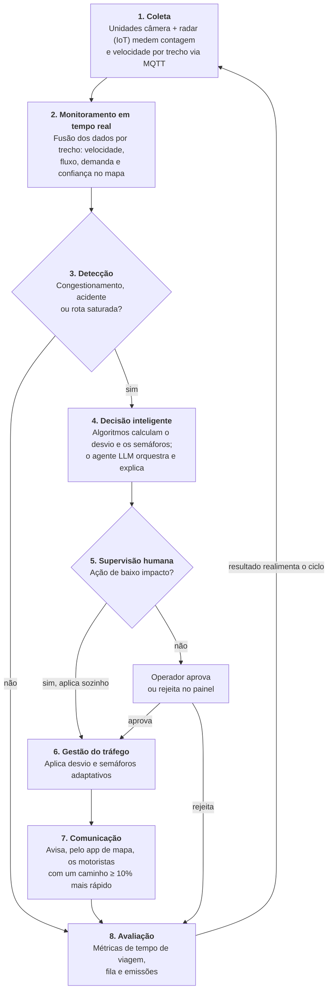
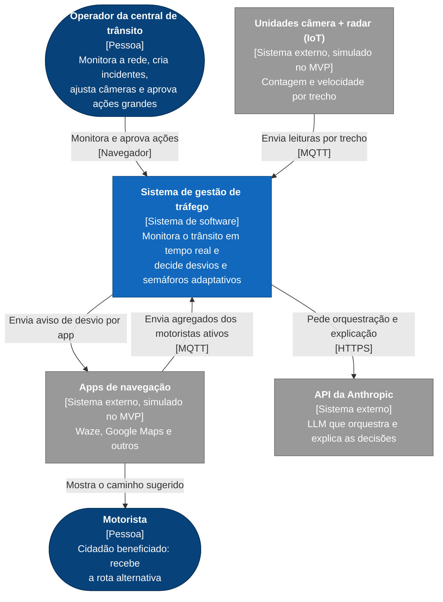
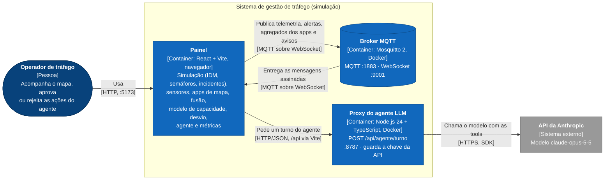

# Getting started

Para instalar e rodar, veja o [DEVELOPMENT.md](DEVELOPMENT.md). Este documento explica **para que
serve a ferramenta, o que ela faz e quais conceitos ela usa**.

## Propósito

Painel de gestão de tráfego para o **operador da central de trânsito**. A ferramenta simula o
trânsito de uma grade de 4×4 ruas reais dos Jardins, em São Paulo, mede a rede com unidades de
câmera e radar e decide como agir quando há congestionamento: ajusta os semáforos e avisa **só
uma parte** dos motoristas que usam app de mapa, sugerindo um caminho mais rápido.

**Hipótese do TCC:** notificar apenas uma parcela calculada dos motoristas reduz o tempo médio de
viagem e as emissões de CO₂ mais do que notificar todos ou não fazer nada.

**Impacto:** menos tempo parado e menos anda-e-para significam menos CO₂ (ODS 13 e meta 11.6 da
ONU).

## Como funciona (fluxograma macro)

O ciclo contínuo de monitoramento e gestão inteligente do tráfego:

Por dentro, cada ciclo passa por:

1. A **simulação** move os carros pela grade de 4×4 esquinas (48 trechos, um por sentido de
   cada quarteirão). As viagens começam e terminam nas esquinas da borda, e cada esquina tem um
   semáforo de duas fases (alamedas e ruas).
2. As **unidades câmera + radar** leem contagem (câmera) e velocidade (radar) por trecho, com
   ruído, e publicam via **MQTT**.
3. Os **apps de mapa** (Waze, Google Maps, Outros) publicam só agregados dos seus motoristas:
   quantos estão ativos e a demanda por trecho.
4. A **fusão** junta leituras, alertas e demanda por trecho e calcula a confiança de cada estimativa.
5. O **modelo de capacidade** aprende quanto cada trecho aguenta e calcula a densidade e a folga.
6. A **decisão** ajusta os semáforos e, num trecho congestionado, escolhe quantos motoristas
   avisar. Só recebem o aviso os que usam app e têm um caminho pelo menos 10% mais rápido.
7. O **agente LLM** aciona essas decisões por ferramentas e explica cada uma num log. Ações acima
   dos limites esperam a aprovação do operador.

Os números vêm sempre dos algoritmos determinísticos. O LLM não calcula nada: ele orquestra e
explica.

## Arquitetura (C4, nível 1: contexto)

## Arquitetura (C4, nível 2: containers)

No MVP, as unidades câmera + radar e os apps de mapa são simulados dentro do painel.

Tópicos MQTT:

| Tópico | Quem publica | Quem assina |
| --- | --- | --- |
| `transito/sensores/{id}/telemetria` | unidades câmera + radar (`TelemetryPublisher`) | fusão, painel de telemetria |
| `transito/alertas` | `AlertPublisher` | fusão |
| `transito/apps/ativos` | apps de mapa (`AppFleet`), a cada 10 s | fusão (demanda por trecho), painel dos apps |
| `transito/notificacoes/{app}` | `AppNotifier` (`waze`, `google-maps`, `outros`) | painel dos apps, `Simulation` |

O broker e o proxy são opcionais: sem o broker, o transporte fica offline; sem o proxy ou sem a chave, o agente usa as regras locais ("modo sem LLM").

## Funcionalidades

O painel tem quatro abas: **Mapa ao vivo**, **Câmeras**, **Semáforos** e **Relatórios**.

### Mapa ao vivo
- Camadas que ligam e desligam: **Densidade**, **Câmeras** e **Incidentes**. Zoom e arrasto.
- Trechos coloridos pela densidade (fluxo ÷ capacidade aprendida): livre, moderado, intenso ou
  crítico. Trechos sem capacidade ainda aparecem como "aprendendo"; sem leitura há 20 s, "sem dado".
- Um rótulo por rua com o pior trecho dela, em carros/min.
- Ícones das câmeras (online ou offline) e marcadores de incidentes com nota.
- Ao clicar numa via: detalhes do trecho e o fluxo e a velocidade das últimas 2 h.
- Ranking das ruas mais saturadas, cards com métricas reais e lista de incidentes ativos.
- Os carros são simulados, mas não aparecem no mapa: o foco são as métricas.

### Incidentes (criados no mapa)
- **Acidente:** clicar numa via bloqueia o trecho (2 min por padrão); clicar no bloqueio libera.
- **Obra:** limita o trecho a 20 km/h por 10 min.
- **Semáforo intermitente:** a esquina fica em amarelo piscante por 10 min, e os carros passam
  em revezamento.
- Congestionamentos com desvio ativo também entram no log de incidentes, com histórico.

### Câmeras
- Adicionar, remover e ajustar posição, direção, ângulo e alcance das unidades. A cobertura se
  recalcula na hora.
- Status da telemetria MQTT por unidade.

### Semáforos (controle da operação)
- Volume de carros, ruído das leituras, **Desvio parcial** e **Controle de semáforos**
  (adaptativo) liga/desliga.
- Agente: log com a explicação de cada decisão e cards para aprovar ou rejeitar ações grandes.
- **Modo sem LLM:** sem chave de API ou com a API fora do ar, as mesmas regras rodam com
  explicações por modelo de texto.
- Painel dos apps: motoristas ativos por app, avisos enviados e motoristas fora do alcance
  (no trecho, mas sem app).

### Relatórios
- Tempo médio de viagem, fila total, % desviado e gráfico dos últimos 10 min.
- Curva de capacidade do trecho selecionado.
- Histórico de incidentes.
- **Experimentos:** roda 3 cenários com o mesmo acidente (trecho `I12>I13`, aos 5 min de uma
  rodada de 15 min) e a mesma demanda: **sem sistema**, **notificar todos** e **desvio parcial**.
  Repetições com semente (resultado reproduzível), duração do acidente (2 ou 5 min) e demanda
  (10-20 carros/min). Mostra média e desvio-padrão, um gráfico comparativo e exporta **CSV** para
  o TCC.

## Conceitos

| Conceito | O que é |
| --- | --- |
| **Grade** | 4 alamedas (Santos, Jaú, Itu, Franca) × 4 ruas (Consolação, Bela Cintra, Haddock Lobo, Augusta), com as 16 esquinas tiradas do OpenStreetMap. |
| **Trecho** | Um quarteirão num sentido, entre duas esquinas (são 48, com id como `I12>I13`). É a unidade de decisão: capacidade, estado e desvio são por trecho. |
| **Unidade câmera + radar** | Poste com uma câmera, que conta os carros no seu cone (posição, direção, ângulo e alcance), e um radar de feixe estreito (12°, 150 m) na mesma direção, que mede a velocidade com metade do ruído. Começam 12 unidades; metade dos trechos fica sem câmera. |
| **Cobertura** | Fração do trecho dentro do cone de uma câmera. Abaixo de 0,3, a câmera não mede o trecho. |
| **Janela** | Período de 10 s em que a câmera agrega as leituras antes de publicar. |
| **MQTT** | Protocolo de mensagens IoT. As unidades e os apps publicam no broker Mosquitto; a fusão assina os tópicos. |
| **Fusão** | Junta unidades, alertas e demanda num estado único por trecho. Se duas câmeras veem o mesmo trecho, vale a de maior cobertura. Alertas a menos de 50 m viram um só. |
| **Estimado** | Trecho sem câmera no momento: usa a última medição e fica marcado como "estimado". |
| **Confiança** | Quanto confiar na estimativa: sobe com a cobertura e cai com a idade do dado. |
| **Apps de mapa** | 60% dos motoristas usam um app (Waze 40%, Google Maps 50%, Outros 10%). A cada 10 s, os apps publicam só agregados: motoristas ativos por app e por trecho e a demanda por trecho no último minuto, escalada para todos os motoristas (LGPD: a fusão nunca vê viagens ou posições). |
| **Diagrama fundamental** | Relação entre fluxo (q), densidade (k) e velocidade (v) do tráfego: q = k × v. |
| **Capacidade** | Fluxo máximo do trecho. É aprendido online pelo modelo de Greenshields (a velocidade cai em linha reta com a densidade) com mínimos quadrados recursivos (RLS): q_max = v_f × k_j / 4. |
| **Estado** | Velocidade média ÷ velocidade regulamentar: **fluindo** ≥ 80%, **carregado** 50-80%, **congestionado** < 50%. É o que a decisão usa. |
| **Densidade** | O que o mapa mostra: fluxo ÷ capacidade. **Livre** < 50%, **moderado** 50-74%, **intenso** 75-89%, **crítico** ≥ 90% ou velocidade abaixo de metade do limite. |
| **Folga** | Capacidade − fluxo atual. É o que o caminho alternativo ainda absorve. |
| **Desvio parcial** | N = min(excesso do trecho congestionado, folga × 0,8) e p = min(N ÷ demanda, 50%). A cada janela, avisa no máximo p × candidatos, os de maior ganho primeiro. Candidato é quem usa app e ainda vai passar pelo trecho; só recebe o aviso se o caminho alternativo levar no máximo 90% do tempo atual. "Notificar todos" avisa todos os que passam nesse teste. |
| **Fora do alcance** | Carros no trecho congestionado sem app (contagem da câmera − motoristas dos apps): o sistema não consegue avisá-los. |
| **Histerese** | Evita o liga-desliga: o desvio só começa depois de 5 janelas seguidas de congestionamento (50 s), só para depois de 2 janelas a 35 km/h ou mais e nunca muda menos de 30 s depois da última mudança. |
| **Semáforo** | Cada esquina alterna duas fases: alamedas e ruas. No modo fixo, 20 s de verde e 3 s de amarelo por fase, com uma onda verde de 10 s por quarteirão. |
| **Semáforo adaptativo coordenado** | Em cada esquina, o verde de uma fase = 20 s + 2 × (fila da fase − fila média das duas fases), limitado a 15-30 s e calculado quando a fase começa. |
| **Autonomia** | Desvio de até 30% dos carros e verde de 20 ± 10 s são aplicados direto. Acima disso, a ação vira um card para o operador aprovar. |
| **Emissão de CO₂** | Por carro, a cada tick: em movimento, g/km conforme a velocidade; parado, g/s de marcha lenta. |
| **Semente** | Número que fixa a aleatoriedade das chegadas. Mesma semente = mesma rodada, o que permite comparar cenários de forma justa. |

## Métricas dos experimentos

Tempo médio de viagem, CO₂ total e por km, tempo parado por veículo, fila máxima, tempo até
normalizar após o acidente e saturação da rota alternativa (% da capacidade).

## Tecnologias

- **Frontend e simulação:** React, TypeScript, Vite e Canvas; Turf.js e rbush para a geometria.
- **Movimento dos carros:** Intelligent Driver Model (IDM).
- **IoT:** MQTT com o broker Mosquitto (Docker).
- **LLM:** API da Anthropic com tool calling, por um proxy Node em `server/` (container Docker) que guarda a chave.
- **Testes:** Vitest e Testing Library.

## Estrutura do código (`src/src`)

| Pasta | Conteúdo |
| --- | --- |
| `sim/` | Grade da cidade, grafo, motor da simulação, IDM, semáforos, incidentes (acidente, obra, intermitente) |
| `sensors/` | Trechos, unidades câmera + radar, índice de cobertura, leitura por janela |
| `telemetry/` | Transporte MQTT |
| `apps/` | Apps de mapa: sorteio do app, agregados dos motoristas ativos, avisos por app |
| `fusion/` | Estado fundido, confiança, alertas |
| `capacity/` | Modelo de capacidade (Greenshields + RLS) |
| `decision/` | Desvio parcial (histerese), escolha de quem avisar, log de incidentes, histórico por trecho, métricas |
| `agent/` | Agente LLM, ferramentas, política de autonomia, fila de aprovação, log |
| `experiments/` | Cenários, emissão de CO₂, CSV |
| `render/` | Painel (abas), mapa, níveis de densidade, rótulos e painéis |

## Fora do MVP

Drones e camada móvel, feed do Waze for Cities, editor de zonas, seletor de canal de notificação,
integrações reais com apps de navegação e visão computacional real.
