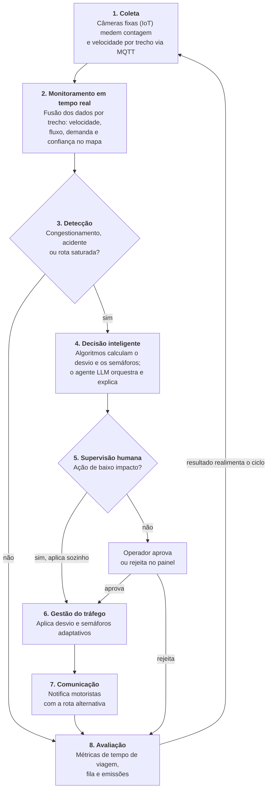
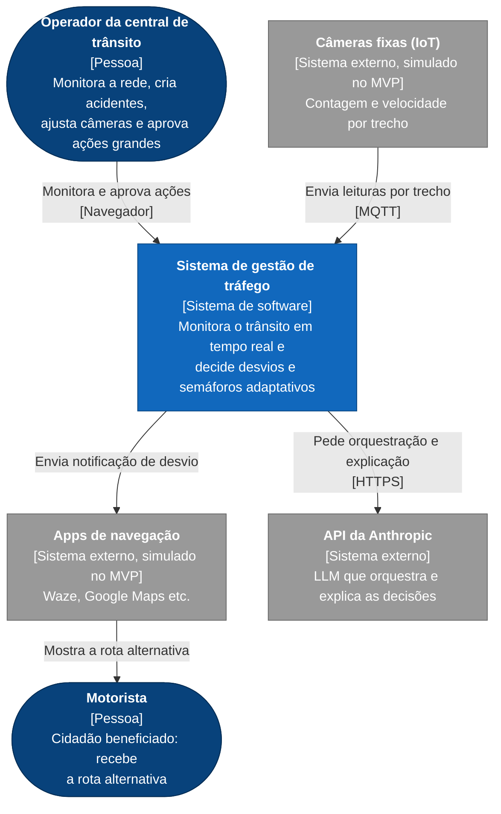
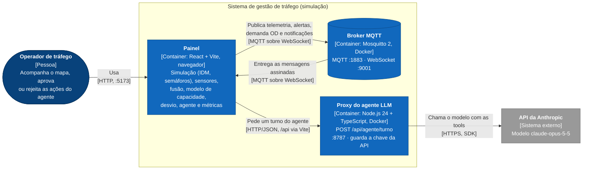

# Getting started

Para instalar e rodar, veja o [DEVELOPMENT.md](DEVELOPMENT.md). Este documento explica **para que
serve a ferramenta, o que ela faz e quais conceitos ela usa**.

## Propósito

Painel de gestão de tráfego para o **operador da central de trânsito**. A ferramenta simula o
trânsito de um bairro, mede a rede com câmeras fixas e decide como agir quando há
congestionamento: ajusta os semáforos e desvia **só uma parte** dos motoristas para uma rota
alternativa.

**Hipótese do TCC:** notificar apenas uma parcela calculada dos motoristas reduz o tempo médio de
viagem e as emissões de CO₂ mais do que notificar todos ou não fazer nada.

**Impacto:** menos tempo parado e menos anda-e-para significam menos CO₂ (ODS 13 e meta 11.6 da
ONU).

## Como funciona (fluxograma macro)

O ciclo contínuo de monitoramento e gestão inteligente do tráfego:

Por dentro, cada ciclo passa por:

1. A **simulação** move os carros pela malha (origem → 3 rotas → destino, 4 semáforos).
2. As **câmeras fixas** leem contagem e velocidade por trecho, com ruído, e publicam via **MQTT**.
3. A **fusão** junta as leituras por trecho e calcula a confiança de cada estimativa.
4. O **modelo de capacidade** aprende quanto cada trecho aguenta e calcula a folga.
5. A **decisão** ajusta semáforos e calcula quantos carros desviar.
6. O **agente LLM** aciona essas decisões por ferramentas e explica cada uma num log. Ações acima
   dos limites esperam a aprovação do operador.

Os números vêm sempre dos algoritmos determinísticos. O LLM não calcula nada: ele orquestra e
explica.

## Arquitetura (C4, nível 1: contexto)

## Arquitetura (C4, nível 2: containers)

No MVP, as câmeras e a notificação aos motoristas são simuladas dentro do painel.

Tópicos MQTT:

| Tópico | Quem publica | Quem assina |
| --- | --- | --- |
| `transito/sensores/{id}/telemetria` | sensores simulados (`TelemetryPublisher`) | fusão, painel de telemetria |
| `transito/alertas` | `AlertPublisher` | fusão |
| `transito/demanda/od` | `OdAggregator` | fusão |
| `transito/notificacoes` | agente (`AgentRunner`) | motoristas (simulado) |

O broker e o proxy são opcionais: sem o broker, o transporte fica offline; sem o proxy ou sem a chave, o agente usa as regras locais ("modo sem LLM").

## Funcionalidades

### Mapa
- Trechos coloridos pelo estado: fluindo, carregado ou congestionado.
- Camada **Cobertura**: cones das câmeras e trechos coloridos pela % coberta; os descobertos ficam
  destacados.
- Tooltip por trecho: sensores, fontes, confiança, idade do dado, alertas e demanda.
- Os carros são simulados, mas não aparecem no mapa: o foco são as métricas.

### Ações do operador
- **Acidente:** ativar o modo e clicar numa via cria um bloqueio (2 min por padrão).
- **Câmeras:** adicionar, remover e ajustar posição, direção, ângulo e alcance. A cobertura se
  recalcula na hora.
- **Semáforo adaptativo:** botão para ligar e desligar.
- **Aprovação:** aprovar ou rejeitar os cards de ação do agente.
- **Ruído:** ajustar o ruído da leitura das câmeras.

### Métricas em tempo real
- Tempo médio de viagem, fila total, % desviado e gráfico dos últimos 10 min.
- Curva de capacidade do trecho selecionado.
- Status da telemetria MQTT.

### Agente
- Log com a explicação de cada decisão.
- Cards de aprovação para ações grandes.
- Notificação simulada ao motorista, no app de mapa que ele já usa (Waze, Google Maps etc.).
- **Modo sem LLM:** sem chave de API ou com a API fora do ar, as mesmas regras rodam com
  explicações por modelo de texto.

### Experimentos
- Roda 3 cenários com o mesmo acidente e a mesma demanda: **sem sistema**, **notificar todos** e
  **desvio parcial**.
- Repetições com semente (resultado reproduzível) e escolha da duração do acidente e da demanda.
- Mostra média e desvio-padrão, um gráfico comparativo e exporta **CSV** para o TCC.

## Conceitos

| Conceito | O que é |
| --- | --- |
| **Trecho** | Pedaço de via entre dois nós da malha (são 11). É a unidade de decisão: capacidade, estado e desvio são por trecho. |
| **Câmera fixa** | Sensor com campo de visão em cone (posição, direção, ângulo e alcance). Só conta carros dentro do cone. |
| **Cobertura** | Fração do trecho dentro do cone de uma câmera. Abaixo de 0,3, a câmera não mede o trecho. |
| **Janela** | Período de 10 s em que a câmera agrega as leituras antes de publicar. |
| **MQTT** | Protocolo de mensagens IoT. As câmeras publicam no broker Mosquitto; a fusão assina os tópicos. |
| **Fusão** | Junta câmeras, alertas e demanda num estado único por trecho. Se duas câmeras veem o mesmo trecho, vale a de maior cobertura. Alertas a menos de 50 m viram um só. |
| **Estimado** | Trecho sem câmera no momento: usa a última medição e fica marcado como "estimado". |
| **Confiança** | Quanto confiar na estimativa: sobe com a cobertura e cai com a idade do dado. |
| **Demanda OD** | Viagens agregadas de origem para destino, publicadas a cada 60 s. Células com menos de 5 viagens são descartadas (LGPD: a fusão nunca vê carros individuais). |
| **Diagrama fundamental** | Relação entre fluxo (q), densidade (k) e velocidade (v) do tráfego: q = k × v. |
| **Capacidade** | Fluxo máximo do trecho. É aprendido online pelo modelo de Greenshields (a velocidade cai em linha reta com a densidade) com mínimos quadrados recursivos (RLS): q_max = v_f × k_j / 4. |
| **Estado** | Velocidade média ÷ velocidade regulamentar: **fluindo** ≥ 80%, **carregado** 50-80%, **congestionado** < 50%. |
| **Folga** | Capacidade − fluxo atual. É o que a rota alternativa ainda absorve. |
| **Desvio parcial** | Desvia N = min(excesso da rota congestionada, folga da alternativa × fator de segurança) carros. Só os que ainda não entraram na rota são desviados. |
| **Histerese** | Evita o liga-desliga: o desvio só começa depois de 5 janelas seguidas de congestionamento (50 s) e só para abaixo de um limite mais baixo. |
| **Semáforo adaptativo coordenado** | Verde = 20 s + 2 × (fila da aproximação − fila média), limitado a 15-30 s. O vermelho vai até o próximo início do ciclo de 43 s, com pelo menos 10 s, para manter a onda verde. |
| **Autonomia** | Desvio de até 30% dos carros e verde de 20 ± 10 s são aplicados direto. Acima disso, a ação vira um card para o operador aprovar. |
| **Emissão de CO₂** | Por carro, a cada tick: em movimento, g/km conforme a velocidade; parado, g/s de marcha lenta. |
| **Semente** | Número que fixa a aleatoriedade das chegadas. Mesma semente = mesma rodada, o que permite comparar cenários de forma justa. |

## Métricas dos experimentos

Tempo médio de viagem, CO₂ total e por km, tempo parado por veículo, fila máxima, tempo até
normalizar após o acidente e saturação da rota alternativa (% da capacidade).

## Tecnologias

- **Frontend e simulação:** React, TypeScript, Vite e Canvas; Turf.js e rbush para a geometria.
- **Movimento dos carros:** Intelligent Driver Model (IDM).
- **IoT:** MQTT com o broker Mosquitto (Docker).
- **LLM:** API da Anthropic com tool calling, por um proxy Node em `server/` (container Docker) que guarda a chave.
- **Testes:** Vitest e Testing Library.

## Estrutura do código (`src/src`)

| Pasta | Conteúdo |
| --- | --- |
| `sim/` | Motor da simulação, IDM, semáforos, acidentes |
| `sensors/` | Trechos, câmeras, índice de cobertura, leitura por janela |
| `telemetry/` | Transporte MQTT |
| `fusion/` | Estado fundido, confiança, alertas, demanda OD |
| `capacity/` | Modelo de capacidade (Greenshields + RLS) |
| `decision/` | Desvio parcial, métricas |
| `agent/` | Agente LLM, política de autonomia, fila de aprovação, log |
| `experiments/` | Cenários, emissão de CO₂, CSV |
| `render/` | Mapa e painéis |

## Fora do MVP

Drones e camada móvel, feed do Waze for Cities, editor de zonas, seletor de canal de notificação,
integrações reais com apps de navegação e visão computacional real.
