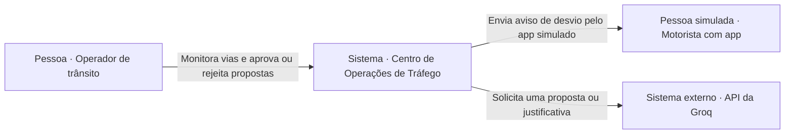
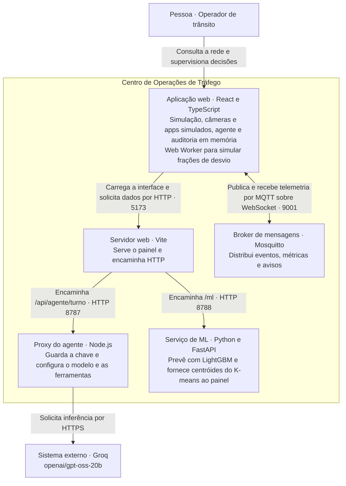

# FIAP - Faculdade de Informática e Administração Paulista

<p align="center">
<a href="https://www.fiap.com.br/">
  
</a>
</p>

<br>

# Centro de Operações de Tráfego

## Equipe da turma 2TIAO

## 👨‍🎓 Integrantes:

- Edson Henrique Felix Batista — RM 566321
- Jonas Luis da Silva — RM 561465

Os dois integrantes realizaram o projeto em conjunto. A entrega reúne engenharia de tráfego (filas, capacidade e alternativas), engenharia de dados e IoT (telemetria e pareamento), ciência de dados (treino e avaliação) e desenvolvimento web (painel, agente e auditoria).

## 👩‍🏫 Professores:

### Tutor(a)
- <a href="Link do perfil no LinkedIn">Nome do Tutor</a>
  
### Coordenador(a)

- <a href="https://www.linkedin.com/in/andregodoichiovato/">André Godoi Chiovato</a>

## 📜 Descrição

Em São Paulo, percorrer 10 km de carro levou em média **27 min 39 s em 2025**. Quando um acidente bloqueia uma rua, recomendar a mesma alternativa a todos pode transferir a fila para a via vizinha. Esta POC CitizenTech ajuda o **operador da central municipal de trânsito** a decidir quantos motoristas avisar, quando manter a rota e quando ajustar o próximo verde. Os beneficiários são tanto os motoristas que se aproximam do bloqueio quanto as pessoas que já circulam pelas vias alternativas. [TomTom Traffic Index, São Paulo](https://www.tomtom.com/traffic-index/city/sao-paulo/)

**Origem e uso dos dados**

| Natureza | Fonte | Como é usada e qual é o limite |
| --- | --- | --- |
| Indicador real de mobilidade | TomTom Traffic Index, São Paulo, 2025 | A média municipal contextualiza o problema. Sua escala é a cidade, enquanto a avaliação do protótipo cobre apenas um recorte dos Jardins. |
| Geografia real | Coordenadas de 16 cruzamentos de quatro alamedas com quatro ruas, extraídas do OpenStreetMap e registradas no código | As coordenadas definem a geometria dos 48 trechos direcionais da malha. A demanda e a velocidade de cada trecho são geradas separadamente. [Malha e coordenadas](src/src/sim/cityNetwork.ts) · [© colaboradores do OpenStreetMap](https://www.openstreetmap.org/copyright) |
| Telemetria e treino sintéticos | O motor gera viagens, placas fictícias, passagens pelas câmeras, adesão aos apps e incidentes. O gerador de episódios exporta esse tráfego em CSV. | A semente permite repetir um cenário, treinar os modelos e comparar estratégias sob a mesma demanda. Sensores e apps simulados permitem testar falhas e acidentes sem coletar dados pessoais de motoristas reais. [Gerador de episódios](src/src/dataset/episode.ts) |
| Resultados da POC | Auditoria em JSON e experimentos em CSV | A auditoria registra o que o agente ou a regra decidiu naquela sessão. O CSV reúne resultados por estratégia. Tempo, fila e CO₂ descrevem a simulação; o CO₂ é estimado com coeficientes ilustrativos. [Modelo de emissão](src/src/experiments/emission.ts) |

**O que o avaliador consegue verificar no painel**

| Página | O que observar ou fazer |
| --- | --- |
| **Mapa ao vivo** | Selecionar um trecho para ver velocidade, fluxo, ocupação e previsão disponível. Criar um acidente, uma obra ou um semáforo intermitente. Um acidente registrado pelo operador bloqueia a via. Já um alerta de **Possível incidente** detectado pelas câmeras pede **Confirmar incidente** antes de aplicar um desvio. |
| **Câmeras** | Conferir a conexão MQTT, as 24 câmeras que formam os 12 pares monitorados e os últimos eventos de passagem, com horário e identificador protegido. |
| **Semáforos** | Ver a fase e o tempo restante de cada cruzamento, ativar o controle adaptativo ou normalizar um sinal intermitente. |
| **Desvio** | Ver o trecho evitado, a fração calculada, os avisos por aplicativo e a justificativa do agente. Aprovar ou rejeitar propostas acima dos limites automáticos. |
| **Relatórios** | Consultar a **Auditoria do agente** e baixar a sessão em JSON. Comparar estratégias na área de **Experimentos**, ver médias e desvios-padrão e exportar as rodadas em CSV. |

**Resultados observados.** Em uma rodada da apresentação, a auditoria registrou duas decisões automáticas de origem **agente**. Aos 13 s simulados, o agente aplicou desvio de **20%** na Alameda Santos, entre Bela Cintra e Haddock Lobo. Aos 40 s, programou **25 s de verde** para a alameda no cruzamento I22, com 11 veículos esperando nessa fase e um na transversal.

Em um experimento separado, com 75 veículos/min, semente 1001 e acidente de cinco minutos, o trecho chegou a 94,4% de ocupação. Havia no máximo um motorista elegível por janela de dez segundos. Desviar aumentava a ocupação da alternativa sem aliviar a fila. A política escolheu **0%**, com tempo médio de **52,54 s** por viagem, ante **52,91 s** sem o sistema. A hipótese de vantagem do desvio parcial permanece em aberto para essa demanda.

## 📁 Estrutura de pastas

Os caminhos abaixo partem de `2TIAO/GLOBAL-SOLUTION-2/`, a pasta que contém este README e o arquivo do Compose.

| Caminho | Papel na versão atual |
| --- | --- |
| `src/` | Aplicação web. Vite inicia o painel; `src/src/App.tsx` conecta o relógio da simulação, as cinco páginas e o agente. |
| Em `src/src/` — `sim/`, `sensors/`, `apps/`, `telemetry/` | Malha, movimento, sinais, sensores simulados, aplicativos e transporte MQTT. |
| Em `src/src/` — `fusion/`, `capacity/`, `forecast/` | Pareamento de passagens, estado por trecho, capacidade, classificação e cliente da previsão. |
| Em `src/src/` — `decision/`, `agent/`, `render/` | Cenários de apresentação, cálculo de desvios, ferramentas e auditoria do agente, mapa e painéis. |
| Em `src/src/` — `dataset/`, `scripts/`, `experiments/`, `integration/` | Geração dos episódios de treino, experimentos comparativos, exportação em CSV e testes com o broker. |
| `server/` | Proxy Node.js em TypeScript. Valida os turnos do agente, configura as ferramentas permitidas e consulta a Groq. |
| `ml/` | API FastAPI em Python 3.12, treino, testes e diretório `modelos/` para os artefatos gerados. |
| `mosquitto/`, `docker-compose.yml` | Configuração do broker e definição dos três serviços locais: `mosquitto`, `agente` e `ml`. |
| `data/treino/`, `notebooks/` | O primeiro recebe o CSV sintético gerado localmente; o segundo está reservado para análises exploratórias. Os experimentos da entrega rodam pelo painel. |
| `docs/`, `output/pdf/` | Documentação complementar e relatório acadêmico, quando incluídos na entrega. |

## 📎 Links e Observações

### 🔗 Links do Projeto

* [Vídeo de apresentação](https://youtu.be/Dei3nepob_0) — demonstração do painel, do agente e da auditoria.
* [Relatório acadêmico em PDF](output/pdf/relatorio-citizentech-transito.pdf) — documento de entrega com integrantes, arquitetura, resultados, testes e limitações.
* [Especificação funcional](especificacao-funcional.md) — problema, requisitos, hipóteses e critérios de avaliação.
* [Guia do protótipo](GETTING_STARTED.md) e [guia de desenvolvimento](DEVELOPMENT.md) — material complementar sobre os conceitos de tráfego e o ambiente local.

### 🧠 Decisões Técnicas

**C1 · Contexto do sistema**

O operador usa a central para acompanhar o trânsito e supervisionar intervenções. Os motoristas, as câmeras e os aplicativos de navegação são simulados na POC. A Groq fornece a inferência externa do modelo de linguagem.



**C2 · Contêineres do sistema**

O painel executa no navegador. O Vite serve a interface e encaminha as chamadas HTTP no ambiente de demonstração. O Docker Compose executa o broker MQTT, o proxy do agente e o serviço de ML.



**Tecnologias escolhidas e responsabilidade na decisão**

| Componente | Entradas e saída | Por que foi escolhido |
| --- | --- | --- |
| **Simulador e interface — TypeScript, React, Canvas e Vite** | O motor IDM atualiza a posição dos veículos e as filas por fase. O mapa em Canvas e as telas React mostram a situação por trecho, os avisos e a fila de aprovação. | A mesma aplicação permite provocar o acidente, acompanhar a decisão e repetir o cenário com semente conhecida. |
| **Sensores e integração — MQTT e Mosquitto** | As câmeras simuladas publicam passagens. O pareamento calcula fluxo e velocidade a cada 10 s sobre o último minuto. A fusão reúne essas medidas com alertas e demanda dos apps. | A publicação por tópicos separa quem produz a leitura de quem a consome. O contrato de evento também é o ponto de integração para um futuro sensor físico que faça a pseudonimização na borda. |
| **ML de previsão — LightGBM, servido por FastAPI** | Quatro regressores recebem o trecho, o calendário e dez leituras com espaçamento de um minuto de velocidade, fluxo e densidade. Produzem velocidade (km/h) e fluxo (veículos/min) para **15 e 30 min**. | As entradas são tabulares e incluem histórico recente. Cada alvo tem seu próprio erro mensurável. O sistema usa o fluxo previsto para antecipar saturação e abrir uma avaliação. [Preparação das amostras](ml/features.py) |
| **ML de classificação — K-means, scikit-learn** | Agrupa leituras padronizadas de velocidade, fluxo e densidade em quatro grupos. Os centróides são ordenados por velocidade e associados aos estados livre, moderado, intenso e crítico. O navegador aplica o centróide mais próximo à leitura atual. | Permite caracterizar o **estado presente** mesmo sem rótulos humanos de congestionamento. O painel permite comparar o agrupamento com a regra de capacidade. [Treino dos modelos](ml/treinar.py) |
| **Simulação de alternativas — Web Worker** | Uma cópia do estado atual testa sete frações de aviso durante dez minutos. Devolve a fração escolhida e os efeitos calculados no trecho e nas alternativas. | O cálculo determinístico torna a proposta conferível. Executá-lo em paralelo à interface mantém o mapa e os controles disponíveis. [Cálculo das frações](src/src/decision/simulateDiversion.ts) |
| **Agente LLM — gpt-oss-20b da OpenAI, via Groq e proxy Node.js** | Recebe o evento, filas por fase e indicadores agregados. Consulta ferramentas e pode propor o desvio calculado, propor a duração do próximo verde ou justificar manter a rota. O proxy mantém no servidor a chave, o prompt e o catálogo de ferramentas. | A IA generativa articula os dados de cada episódio em uma proposta e uma justificativa legível. O prompt exige fundamentação nas leituras e as ferramentas devolvem o resultado da proposta. [Prompt e ferramentas](server/src/agentConfig.ts) |
| **Execução e supervisão — política de autonomia e operador** | O código valida a proposta e decide se ela pode ser aplicada, se exige aprovação ou se deve ser recusada. O operador decide sobre as propostas encaminhadas. | Os mesmos limites se aplicam quando a origem da proposta é o agente ou a regra local. Evento, justificativa, estado e origem permanecem consultáveis. [Política](src/src/agent/policy.ts) · [Auditoria](src/src/agent/ProposalAudit.ts) |

**Por que escolhemos K-means?** A conta `fluxo ÷ capacidade` pode dar o mesmo valor para duas vias de igual capacidade que escoam dez carros por minuto, mesmo que em uma os carros andem depressa e na outra avancem devagar em fila.
O K-means combina velocidade, fluxo e densidade e aprende perfis nos dados simulados, sem exigir rótulos humanos ou limites definidos à mão para cada combinação.
A regra operacional também considera baixa velocidade e serve de referência e contingência. Os 68% medem concordância entre métodos nos dados sintéticos. Avaliar qual classifica melhor exige observações reais rotuladas.

**Como a central usa essas saídas**

- **Alerta.** O modelo de capacidade começa com um valor configurado e, quando há amostras válidas suficientes, passa a usar o ajuste de Greenshields por mínimos quadrados recursivos. Com histórico suficiente, a previsão é consultada a cada minuto simulado. Ocupação prevista a partir de 90% da capacidade em 15 min abre o alerta; abaixo de 80%, ele é encerrado.
- **Desvio.** O simulador testa 0%, 10%, 20%, 30%, 40%, 50% e 100%. Escolhe a menor fração que mantém o trecho e as alternativas abaixo de 90% de ocupação. Se nenhuma atender, escolhe a de menor pior ocupação, com preferência pela menor fração em caso de empate. Só recebe aviso quem tem app, ainda vai passar pelo trecho e dispõe de uma alternativa pelo menos 10% mais rápida. Desvios positivos de até 30% podem ser automáticos; acima disso, o operador tem 120 s simulados para decidir.
- **Semáforo.** O agente compara as filas das duas fases e propõe um tempo para o próximo verde. Com controle ativo, a faixa de 10 a 30 s admite aplicação automática; de 31 a 60 s a proposta exige aprovação. Valores fora desses limites são recusados.
- **Acompanhamento.** Dez minutos simulados após um desvio aplicado, a auditoria acrescenta as medidas disponíveis de ocupação no trecho e nas alternativas e o tempo médio de viagem. Para conservar o registro antes de recarregar o painel, use **Relatórios → Baixar auditoria**.

**Mensagens MQTT usadas na demonstração**

| Tópico | Informação |
| --- | --- |
| `transito/vias/{trecho}/eventos` | Passagens individuais emitidas pelas câmeras para o pareamento. |
| `transito/vias/{trecho}/metricas` e `transito/vias/{trecho}/anomalia` | Métricas agregadas e abertura ou encerramento de um possível incidente. |
| `transito/cameras/{id}/status` e `transito/alertas` | Presença das câmeras e alertas de trânsito. |
| `transito/apps/ativos` e `transito/notificacoes/{app}` | Demanda agregada e avisos enviados aos aplicativos simulados. |

**Experimento de impacto.** Em **Relatórios → Experimentos**, compare **Sem sistema**, **Notificar todos** e **Desvio parcial**. Cada repetição usa o mesmo acidente e as mesmas condições iniciais nas três estratégias. A rodada dura 25 min simulados; o acidente começa aos 5 min no trecho I12>I13. É possível variar repetições, demanda (75 a 150 veículos/min) e duração do bloqueio (2 ou 5 min). O CSV permite comparar tempo médio de viagem, espera, fila máxima, tempo de recuperação, ocupação da alternativa e CO₂ estimado, total e por quilômetro.

**Qualidade e avaliação do ML.** Na regressão, a separação 80/20 é feita por episódio para evitar que minutos vizinhos da mesma viagem simulada apareçam nos dois conjuntos. O treino identifica a versão pelo hash do CSV e registra os episódios, o número de amostras e o erro absoluto médio (MAE) por alvo. A referência de persistência usa o último valor disponível. No treino sintético local de versão `v2-f2b424acc11b` (160 episódios de treino e 40 de teste), os resultados foram:

| Alvo previsto | MAE do LightGBM | MAE da persistência |
| --- | ---: | ---: |
| Velocidade em 15 min | 2,72 km/h | 3,66 km/h |
| Velocidade em 30 min | 2,85 km/h | 3,75 km/h |
| Fluxo em 15 min | 1,55 veículos/min | 2,25 veículos/min |
| Fluxo em 30 min | 1,57 veículos/min | 2,23 veículos/min |

Nesse conjunto, os quatro erros ficaram abaixo da referência. Para o K-means, a medida disponível é a **concordância de 68,0% com a regra de tráfego** no conjunto usado no agrupamento. Medir acurácia sobre trânsito observado exigiria leituras de campo rotuladas. Os resultados podem ser reproduzidos pelo passo de treino abaixo e conferidos em `ml/modelos/metricas.json` e `ml/modelos/kmeans.json`.

**Governança, privacidade e riscos**

| Questão | Controle implementado e limite |
| --- | --- |
| Qualidade da leitura | A fusão reduz a confiança conforme a última medição envelhece. Apenas 12 dos 48 trechos têm pares de câmeras; nas outras vias a central depende de estimativas. [Confiança das leituras](src/src/fusion/confidence.ts) |
| Privacidade | As câmeras publicam um identificador HMAC-SHA-256 da placa fictícia, com sal derivado da semente e da hora simulada. O identificador permite parear passagens naquela janela. Os apps fornecem demanda agregada e o agente consulta indicadores por trecho. Uma implantação com placas reais exigiria gestão de chaves, regras de retenção e controle de acesso próprios. [Tratamento das placas](src/src/sensors/plates.ts) |
| Segurança da integração | A credencial da Groq fica no servidor; o Compose publica as portas dos serviços na interface local. O broker da POC permite conexão anônima. Para conectar dispositivos de rua, seriam necessários autenticação dos dispositivos, autorização por tópico e transporte protegido. [Compose](docker-compose.yml) · [Configuração do broker](mosquitto/mosquitto.conf) |
| Respostas do agente | O prompt exige explicar com dados por que agir ou manter a rota. A ferramenta confere a fração e os indicadores enviados pelo modelo e recusa propostas divergentes. O texto pode variar entre rodadas; o registro da ferramenta distingue uma recomendação de uma ação efetivamente aplicada. [Validação das propostas](src/src/agent/tools.ts) |
| Viés de cobertura e impacto | A adesão padrão aos apps é de 60% na simulação. Os motoristas sem app podem ser afetados pela redistribuição do tráfego, embora não recebam o aviso. A avaliação compara também a fila e a saturação nas vias alternativas. Resultados obtidos na malha dos Jardins precisam ser reavaliados para outras regiões e níveis de adesão. [Hipótese de adesão](src/src/apps/apps.ts) |

### 📢 Observações Gerais

* **Participação na Competição:** [ ] Sim, aceitamos participar / [x] Não vamos participar.
* **Validação:** a V3 registrou 24 verificações aprovadas no commit `69669c4`. O teste de apresentação verifica a geração do bloqueio e da fila, um aviso de desvio e um ajuste de verde. A suíte do agente verifica também manutenção de rota com justificativa, aprovação, rejeição e exportação da auditoria. [Teste da apresentação](src/src/decision/PresentationTraffic.test.ts) · [Testes do agente](src/src/agent/v3.test.tsx)
* **Alcance dos resultados:** a simulação 4×4 usa sensores e aplicativos sintéticos. A POC demonstra decisões auditáveis; o benefício no trânsito real requer validação com dados observados. O tempo de viagem e a fila ajudam a avaliar mobilidade (ODS 11). O modelo de emissão estima CO₂ (ODS 13). Avaliar a qualidade do ar da meta 11.6 exigiria medir também poluentes como material particulado.
* **Escopo da V3:** a confirmação de um possível incidente cabe ao operador. Integração com câmeras físicas, drones e plataformas reais de navegação são trabalhos futuros.

## 🔧 Como executar o código

**Pré-requisitos.** Node.js 24 ou superior e npm para o painel. Docker com Compose para os serviços auxiliares. Os blocos desta seção partem da pasta da Global Solution 2. Para chegar a ela a partir da raiz do repositório, execute:

```bash
cd 2TIAO/GLOBAL-SOLUTION-2
```

**1. Iniciar a demonstração.** Para usar o LLM, salve `GROQ_API_KEY=sua_chave` no arquivo local `.env` ao lado de `docker-compose.yml`. O Compose entrega a chave ao proxy. Em seguida, suba a telemetria e o agente, instale o painel e mantenha o Vite em execução:

```bash
docker compose up -d --build mosquitto agente
npm --prefix src ci
npm --prefix src run dev
```

Abra a URL indicada pelo Vite, normalmente [localhost:5173](http://localhost:5173). Em **Mapa ao vivo**, clique em **Iniciar apresentação** e depois em **Ver decisões do agente**. O primeiro acidente ocorre em até 10 segundos simulados. A cada 30 segundos simulados o cenário alterna entre bloqueio e fila. Observe a ação, a origem e o motivo em **Relatórios → Auditoria do agente**. **Encerrar apresentação** interrompe os novos cenários, remove os bloqueios criados pela apresentação e restaura a configuração anterior dos sinais.

**2. Habilitar previsão e classificação por ML.** Em outro terminal, a partir da pasta desta entrega, gere o conjunto de treino, treine os modelos e inicie a API. Quem já possui os artefatos treinados em `ml/modelos/` pode executar apenas a inicialização do serviço.

```bash
npm --prefix src run dataset -- --episodios 200 --semente 1
docker compose build ml
docker compose run --rm ml python -m ml.treinar
docker compose up -d ml
curl -sS http://localhost:8788/ml/saude
```

O gerador produz episódios de 45 min simulados em `data/treino/metricas.csv`. O treino separa episódios entre treino e teste (80/20) e grava os modelos LightGBM, os parâmetros do K-means e `metricas.json` em `ml/modelos/`. O arquivo de métricas inclui o erro absoluto médio (MAE) para comparação com a previsão de persistência. Os dados de treino e os modelos gerados ficam fora do Git. Para ajustar as permissões dos volumes no Linux, o Compose aceita `ML_UID` e `ML_GID` (padrão 1000 para ambos).

**3. Conferir serviços e diagnosticar o painel.** Use `docker compose ps` para ver quais serviços subiram. O Compose completo inclui **três serviços**; o comando da demonstração inicia apenas `mosquitto` e `agente`.

| Componente | Acesso local | O que conferir |
| --- | --- | --- |
| Painel Vite | Porta `5173` por padrão | O painel e a simulação executam no navegador. O Vite encaminha `/api` para o proxy Node e `/ml` para a API Python. |
| Mosquitto | MQTT `1883`, WebSocket `9001` | A aba **Câmeras** mostra o estado da conexão. Se o broker cair, o motor continua, mas as mensagens MQTT deixam de ser entregues. O endereço WebSocket do painel é configurável por `VITE_MQTT_URL` (padrão `ws://localhost:9001`). |
| Proxy do agente | `POST /api/agente/turno` na porta `8787` | Sem chave, sem proxy ou com o provedor indisponível, o painel registra decisões de origem **regra**. Para avaliar a integração com o modelo, confira a origem **agente** na auditoria. |
| Serviço de ML | Porta `8788`: `GET /ml/saude`, `POST /ml/prever`, `GET /ml/kmeans` | `modelo: null` indica que não há modelo de previsão carregado. Sem os artefatos necessários, os endpoints de inferência correspondentes respondem `503`. O painel continua com classificação por regra e indica a indisponibilidade da previsão. |

**Desenvolver o proxy fora do Docker (opcional).** Pare o serviço `agente` para liberar a porta. Execute da pasta da entrega, com o mesmo `.env` configurado acima:

```bash
docker compose stop agente
npm --prefix server ci
npm --prefix server run build
node --env-file=.env server/dist/index.js
```

O processo local usa `HOST=127.0.0.1` e `PORT=8787` por padrão. Para voltar ao proxy em container após editar `server/`, pare o processo local e execute `docker compose up -d --build agente`.

**4. Reproduzir os testes.** Para verificar especificamente a apresentação e a auditoria, com as dependências do painel já instaladas:

```bash
npm --prefix src test -- --run src/agent/v3.test.tsx src/decision/PresentationTraffic.test.ts
```

Para executar as suítes por componente a partir da mesma pasta:

```bash
npm --prefix src test -- --run
npm --prefix src run build
npm --prefix src run lint
docker compose up -d mosquitto
npm --prefix src run test:integration
npm --prefix server ci
npm --prefix server run build
npm --prefix server test -- --run
docker compose run --rm --no-deps ml python -m pytest -p no:cacheprovider ml/tests -v
```

Após gerar o CSV com semente 1 e treinar os modelos no passo 2, valide também os artefatos de treino:

```bash
docker compose run --rm --no-deps ml python -m pytest -p no:cacheprovider ml/tests_treino -v
```

**5. Encerrar.** Use `Ctrl+C` no terminal do Vite e, na pasta desta entrega, execute `docker compose down` para encerrar os serviços.

---

## 📋 Licença

<p xmlns:cc="http://creativecommons.org/ns#" xmlns:dct="http://purl.org/dc/terms/"><a property="dct:title" rel="cc:attributionURL" href="https://github.com/fiap-tutoria/FIAP-PORTFOLIO-AI">TEMPLATE - FIAP PORTFÓLIO AI</a> por <a rel="cc:attributionURL dct:creator" property="cc:attributionName" href="https://fiap.com.br">FIAP</a> está licenciado sobre <a href="http://creativecommons.org/licenses/by/4.0/?ref=chooser-v1" target="_blank" rel="license noopener noreferrer" style="display:inline-block;">Attribution 4.0 International</a>.</p>
